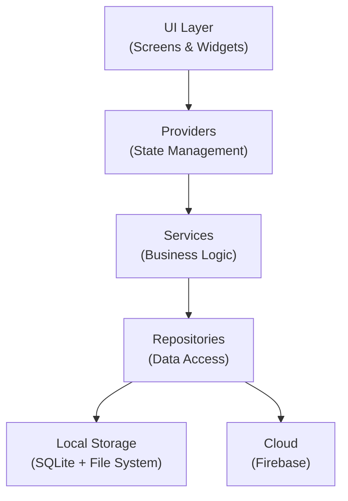
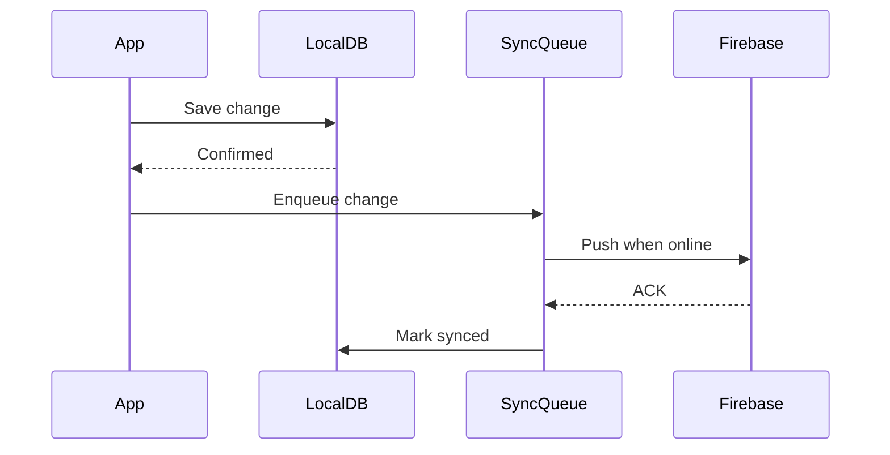

# 🏛️ Finderly — Software Architecture Document (SAD)

## 1. Architecture Overview

**Pattern**: Clean Architecture (Presentation → Domain → Data)
**State Management**: Provider (simplest that works)
**Local DB**: SQLite via `sqflite` + file system storage
**Cloud**: Firebase (Auth + Firestore + Cloud Storage)
**Offline**: Offline-first with sync queue



## 2. Project Structure

```
lib/
├── main.dart
├── app.dart
├── models/
│   ├── folder_model.dart
│   └── file_item_model.dart
├── providers/
│   ├── folder_provider.dart
│   ├── file_provider.dart
│   └── search_provider.dart
├── screens/
│   ├── home_screen.dart
│   ├── folder_screen.dart
│   └── search_screen.dart
├── widgets/
│   ├── folder_card.dart
│   ├── file_tile.dart
│   ├── color_picker_dialog.dart
│   └── folder_icon.dart
├── services/
│   ├── file_service.dart
│   ├── sync_service.dart
│   └── download_service.dart
├── database/
│   └── local_db.dart
└── theme/
    ├── app_theme.dart
    └── folder_colors.dart

assets/
├── folders/
│   ├── folder_blue.png
│   ├── folder_purple.png
│   ├── folder_pink.png
│   ├── folder_red.png
│   ├── folder_orange.png
│   ├── folder_yellow.png
│   ├── folder_green.png
│   └── folder_gray.png
└── icons/
    ├── pdf_icon.png
    ├── image_icon.png
    ├── video_icon.png
    └── file_icon.png
```

## 3. Data Models

```dart
// Folder
class FolderModel {
  String id;
  String name;
  String? parentId;       // null = root
  FolderColor color;      // enum
  DateTime createdAt;
  DateTime updatedAt;
  bool isDownloaded;      // offline flag
}

// File
class FileItemModel {
  String id;
  String name;
  String folderId;
  String localPath;
  String? cloudUrl;
  String mimeType;
  int sizeBytes;
  DateTime createdAt;
  bool isDownloaded;
}
```

## 4. Data Flow — Sync



## 5. Key Technical Decisions

| Decision | Choice | Why |
|----------|--------|-----|
| Framework | Flutter 3.x | Single codebase, 4 platforms, mature |
| Language | Dart 3.x | Null safety, pattern matching, records |
| State | Provider | Simplest, built-in, no boilerplate |
| Local DB | sqflite | Battle-tested, SQL queries for search |
| Cloud | Firebase | Free tier generous, Auth+Firestore+Storage |
| Folder icons | Custom PNG assets | Pixel-perfect macOS look, tinted per color |
| File storage | App documents dir + Cloud Storage | Standard, portable |

## 6. Platform-Specific Notes

| Platform | Note |
|----------|------|
| Android | Uses `path_provider` for app-specific storage |
| iOS | Same, sandboxed storage |
| Windows | Uses `%APPDATA%` via `path_provider` |
| macOS | Uses `~/Library/Application Support/` |
