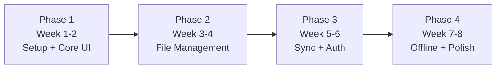

# 📅 Finderly — Management Information Summary (MIS)

## 1. Project Timeline

## 2. Phase Details

### Phase 1: Setup + Core UI (Week 1-2)
- [x] Flutter project scaffolding
- [ ] Folder model + SQLite setup
- [ ] Home screen with folder grid
- [ ] macOS-style folder icons (all 8 colors)
- [ ] Create / rename / delete folder
- [ ] Color picker dialog

### Phase 2: File Management (Week 3-4)
- [ ] File import (any type)
- [ ] File list view inside folders
- [ ] File rename / delete
- [ ] File preview (image thumbnails, PDF icons)
- [ ] Move files between folders
- [ ] Search (global, by name)

### Phase 3: Sync + Auth (Week 5-6)
- [ ] Firebase Auth (email + Google)
- [ ] Firestore folder/file metadata sync
- [ ] Cloud Storage file upload/download
- [ ] Real-time listeners for changes

### Phase 4: Offline + Polish (Week 7-8)
- [ ] Download button (per-file, per-folder)
- [ ] Offline indicator badges
- [ ] Sync queue for offline changes
- [ ] Platform testing (all 4)
- [ ] Performance optimization
- [ ] App icon + splash screen

## 3. Risk Register

| # | Risk | Impact | Mitigation |
|---|------|--------|------------|
| 1 | Large file uploads fail on mobile | High | Chunked upload, retry logic |
| 2 | Sync conflicts lose data | High | Last-write-wins + user notification |
| 3 | Folder icon rendering differs per platform | Medium | Use PNG assets, not platform widgets |
| 4 | Offline storage fills device | Medium | Storage usage indicator, cleanup prompts |
| 5 | Flutter desktop stability | Low | Flutter desktop is stable since 3.x |

## 4. Resource Requirements

| Resource | Details |
|----------|---------|
| Developer | 1 full-stack Flutter developer |
| Designer | Folder icon assets (8 colors × 3 sizes) |
| Backend | Firebase (free tier for MVP) |
| Testing | 4 devices minimum (1 per platform) |
| CI/CD | GitHub Actions or Codemagic |

## 5. Budget Estimate (MVP)

| Item | Cost |
|------|------|
| Firebase (free tier) | \$0 |
| Apple Developer Account | \$99/year |
| Google Play Console | \$25 one-time |
| Microsoft Store | \$19 one-time |
| **Total MVP** | **~\$143** |
