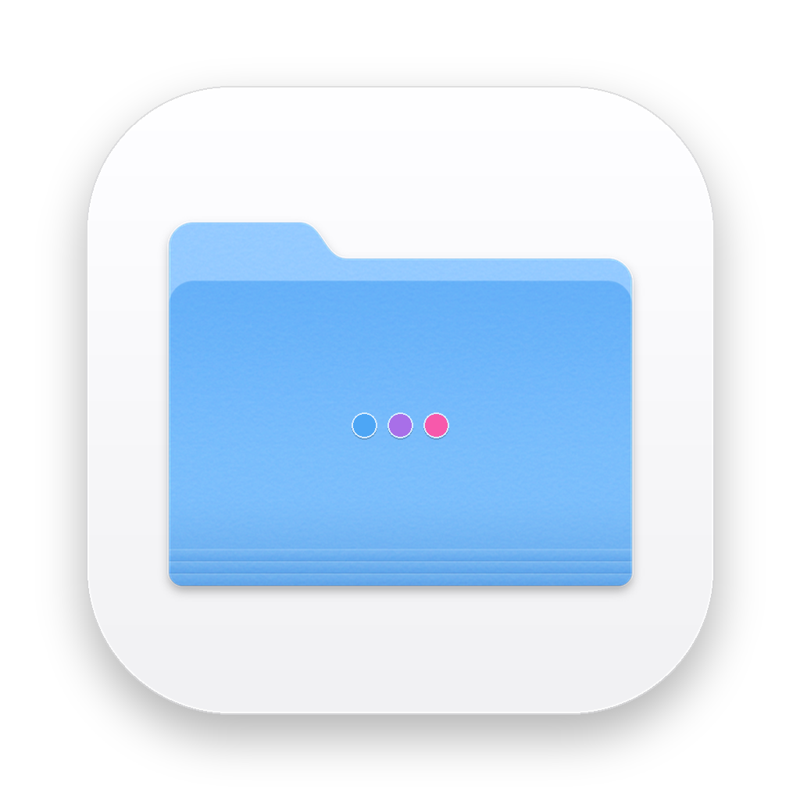
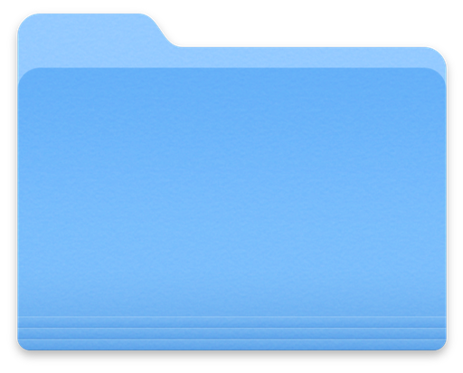
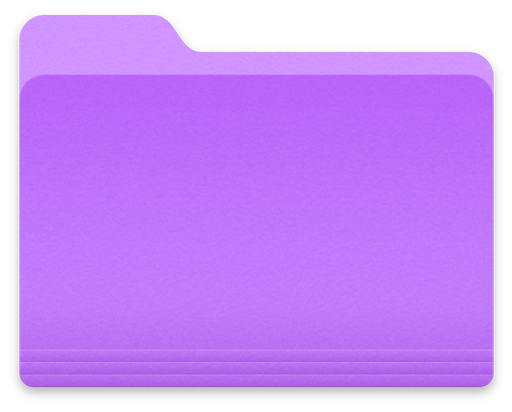
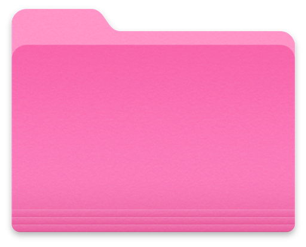
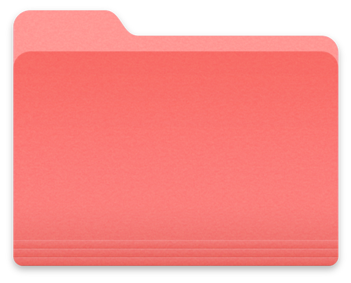
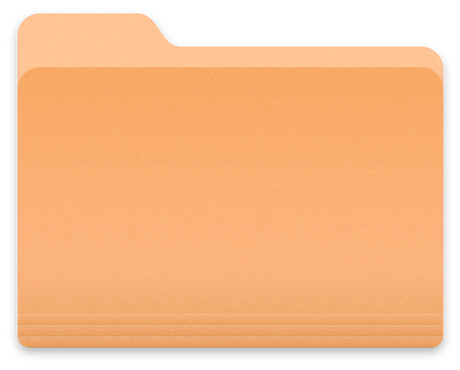
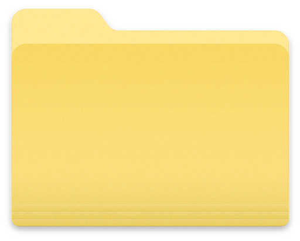
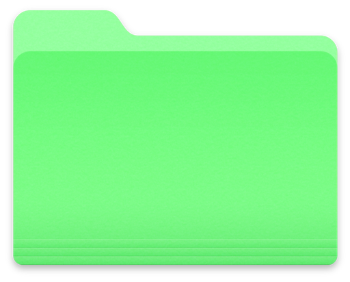
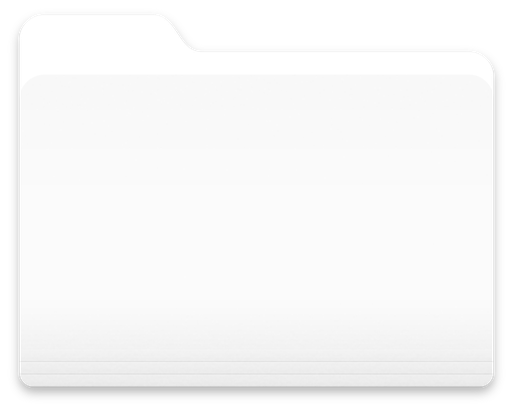

# 📁 Finderly

<div align="center">



### The Elegant, macOS-Style Multiplatform File Organizer
**Android • macOS • Windows • iOS**

[](https://flutter.dev)
[](https://dart.dev)
[-3DDC84?logo=android&logoColor=white)](https://developer.android.com)
[](https://apple.com/macos)
[](https://microsoft.com/windows)
[](LICENSE)

</div>

---

## 🌟 Overview

**Finderly** brings the iconic, pixel-perfect design of macOS Finder folders to **Android, Windows, macOS, and iOS** — in a single, unified, offline-first codebase.

Organize any file type (PDFs, images, documents, videos, archives, spreadsheets) into beautifully color-coded folders with **unlimited nested subfolders**, instant global search, and **multi-device cloud sync** with an offline-ready toggle.

---

## ✨ Features

- 🎨 **Authentic macOS Big Sur / Sonoma Folder Icons**: Sourced directly from native Apple Retina master graphics, available in **8 signature macOS colors** (Blue, Purple, Pink, Red, Orange, Yellow, Green, and Graphite Gray).
- 📂 **Unlimited Sub-Foldering**: Create deep, multi-level folder hierarchies with a dedicated horizontal shelf, breadcrumbs navigation, and cascade deletion.
- 📄 **Universal File Storage**: Store and organize any file format (PDF, DOCX, XLSX, PPTX, MP4, MP3, ZIP, TXT, images).
- 🏷️ **Native macOS Document Badges**: Color-coded folded sheet icons for PDFs, Word, Excel, PowerPoint, ZIP, and media.
- ⚡ **Offline-First & Download Button**: Tap the download icon to keep files permanently offline with clear visual badges (`check_circle` ↔ `cloud_download`).
- 🔄 **Real-Time Cross-Device Sync (P2P Wi-Fi & LAN)**: Built-in local HTTP sync server and UDP beacon discovery for instant two-way sync across phones, laptops, and PCs on the same Wi-Fi with zero configuration and zero cloud delay.
- 📦 **Vault Backup & Migration (.finderly)**: 1-click export and import of your entire vault (all folders, metadata, and physical file bytes) into a single portable `.finderly` archive for offline transfers via AirDrop, Bluetooth, Drive, or USB.
- ☁️ **WebDAV / Nextcloud Support**: Optional remote internet synchronization with self-hosted Nextcloud, ownCloud, or any WebDAV provider.
- 🔍 **Instant Global Search**: Debounced search across both folder names and file names.
- ✏️ **Full Management Controls**: Rename files & folders (on disk and database), change folder colors anytime, share via native OS share sheets.
- 🤖 **Android 8.0+ Ready**: Configured with `minSdk = 26` (Android 8.0 Oreo and above) with adaptive launcher icons.

---

## 🎨 8 Signature Folder Colors

| Color | Hex Reference | Use Case |
|:---:|:---:|---|
|  **Blue** | `#4DA6F5` | Default workspace & general storage |
|  **Purple** | `#A86FE8` | Personal documents & creative media |
|  **Pink** | `#F759AB` | Favorite items & inspirational notes |
|  **Red** | `#F54A45` | Urgent deadlines & high priority |
|  **Orange** | `#FFA940` | Work projects & client deliverables |
|  **Yellow** | `#FFD633` | Archives, reference & receipts |
|  **Green** | `#52C41A` | Completed milestones & financial records |
|  **Graphite** | `#8C8C8C` | Backups & inactive storage |

---

## 📥 Releases & Direct Downloads

Automated builds are compiled by GitHub Actions CI/CD for all target platforms:

| Platform | Download Asset | Target Spec |
|:---|:---|:---|
| 🤖 **Android** | [`finderly-android.apk`](https://github.com/zaryif/Finderly/releases/latest/download/finderly-android.apk) | Min API 26 (Android 8.0+), ARM64 & x86_64 |
| 🍏 **macOS** | [`finderly-macos.dmg`](https://github.com/zaryif/Finderly/releases/latest/download/finderly-macos.dmg) | macOS 11+ Universal (Apple Silicon & Intel) |
| 🪟 **Windows** | [`finderly-windows.zip`](https://github.com/zaryif/Finderly/releases/latest/download/finderly-windows.zip) | Windows 10 / 11 64-bit standalone package |
| 🍎 **iOS** | [`finderly-ios.ipa`](https://github.com/zaryif/Finderly/releases/latest/download/finderly-ios.ipa) | Sideloadable via AltStore / TrollStore / TestFlight |

---

## 🏛️ Architecture & Project Structure

Clean Architecture with `Provider` state management and local-first SQLite (`sqflite` on mobile + `sqflite_common_ffi` on desktop):

```
Finderly/
├── .github/workflows/          # CI/CD multiplatform release builder
│   └── build_releases.yml
├── android/                    # Android runner (minSdk 36, launcher mipmaps)
│   └── app/build.gradle
├── assets/
│   ├── folders/                # 8 Retina macOS folder color assets
│   └── icons/                  # Document badges & App Launcher icons
├── lib/
│   ├── database/
│   │   └── local_db.dart       # SQLite persistence with recursive cascade delete
│   ├── models/
│   │   ├── folder_model.dart   # Folder schema with parentId hierarchy
│   │   └── file_item_model.dart# File schema with offline flags
│   ├── providers/
│   │   ├── folder_provider.dart# Breadcrumbs, subfolders & CRUD
│   │   ├── file_provider.dart  # Multi-file import, rename & disk delete
│   │   └── search_provider.dart# Global debounced search
│   ├── screens/
│   │   ├── home_screen.dart    # Responsive folder grid & sync trigger
│   │   ├── folder_screen.dart  # Subfolder shelf, file list & add FAB
│   │   └── search_screen.dart  # Instant search results
│   ├── services/
│   │   ├── file_service.dart   # File picker, MIME types & disk operations
│   │   └── sync_service.dart   # Multi-device cloud sync manager
│   ├── theme/
│   │   ├── app_theme.dart      # Material 3 light & dark modes
│   │   └── folder_colors.dart  # 8 FolderColor definitions
│   └── widgets/
│       ├── folder_card.dart    # Tappable card with context menu
│       ├── folder_icon.dart    # Exact macOS folder widget with vector fallback
│       ├── file_tile.dart      # Slidable tile with badges & offline button
│       └── color_picker_dialog.dart # 8-color picker modal
├── test/
│   └── models_and_theme_test.dart
└── pubspec.yaml
```

---

## 🚀 Building from Source

### Prerequisites
- [Flutter SDK](https://flutter.dev) (v3.29.0 or later)
- [Dart SDK](https://dart.dev) (v3.6.0 or later)

### Steps
```bash
# 1. Clone repository
git clone https://github.com/zaryif/Finderly.git
cd Finderly

# 2. Install dependencies
flutter pub get

# 3. Run unit tests
flutter test

# 4. Run on your connected device / desktop
flutter run

# 5. Build production binaries
flutter build apk --release        # Android
flutter build macos --release      # macOS
flutter build windows --release    # Windows
flutter build ios --no-codesign    # iOS
```

---

## 📄 Documentation

For full engineering specifications, review the design documents:
- [01 — PRD (Product Requirements)](01_PRD.md)
- [02 — BRD (Business Requirements)](02_BRD.md)
- [03 — SAD (Software Architecture)](03_SAD.md)
- [04 — MIS (Management Information)](04_MIS.md)
- [05 — Assets & Visuals Specification](05_ASSETS_VISUALS.md)
- [06 — Tech Stack Decision](06_TECH_STACK.md)

---

## 📜 License

Distributed under the MIT License. See `LICENSE` for details.

